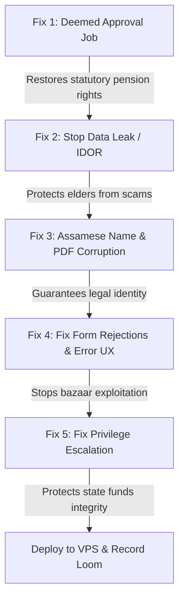

# Master Execution Plan: Sewa Setu (Build for Bharat Take-Home)

This plan outlines the complete, step-by-step roadmap to investigate, fix, test, deploy, and submit the **Sewa Setu Old Age Pension Portal** according to the specifications in [BRIEF.md](file:///c:/Users/prajw/Videos/sewasetu-handout/BRIEF.md).

---

## Overview & Submission Requirements

| Requirement | Deliverable |
| :--- | :--- |
| **Public Deployment** | Live VPS URL (e.g., `http://<VPS_IP>:8000`) with working portal, database, and `/__gateway/` |
| **Top 5 Fixes** | Ranked strictly by citizen impact, with clear justification |
| **Git Commit History** | Strict TDD order for every fix: **Failing Test Commit** $\rightarrow$ **Passing Fix Commit** |
| **Repository** | Private GitHub repo (invite `harshnisar` as collaborator) + ZIP containing `.git` |
| **Assessor Access** | Working admin credentials provided in the application form |
| **Loom Video** | Max 3 minutes (face + screen) explaining findings, Top 5 choices, and what was left alone |

---

## Phase 1: Local Setup & Environment Fixes

### 1.1 Enable Hardware Virtualization in BIOS (Your Laptop)
- Restart your laptop and tap **`F2`** or **`Del`** repeatedly to enter the **ASUS UEFI BIOS Utility**.
- Press **`F7`** to open **Advanced Mode**.
- Navigate to **Advanced** $\rightarrow$ **CPU Configuration**.
- Set **Intel (VMX) Virtualization Technology** to **Enabled**.
- Press **`F10`** to save and restart.

### 1.2 Enable Windows Features & Launch Docker Desktop
1. Press `Win + R`, type `optionalfeatures.exe`, press Enter.
2. Check **Virtual Machine Platform** and **Windows Subsystem for Linux**, click OK.
3. Open **Docker Desktop**. Verify the whale icon in the taskbar turns solid green.

### 1.3 Test Local Deployment
In PowerShell (`c:\Users\prajw\Videos\sewasetu-handout`):
```powershell
docker compose up --build
```
Verify the following URLs:
- Portal: `http://localhost:8000`
- Simulated SMS Gateway: `http://localhost:8000/__gateway/`
- Admin Portal: `http://localhost:8000/admin` (Default: `admin` / `sewasetu@123`)

### 1.4 Initialize Git Repository
```powershell
git init
git add .
git commit -m "chore: initial import of inherited vendor codebase"
```

---

## Phase 2: Top 5 Fixes (Ranked by Citizen Impact)

> [!IMPORTANT]
> For each fix below, you must follow strict Test-Driven Development (TDD) commit hygiene:
> 1. Write the test that reproduces the bug $\rightarrow$ **Commit 1: `test: add failing test for ...`**
> 2. Implement the fix $\rightarrow$ **Commit 2: `fix: resolve ...`**



---

### Fix 1: Restore the Nightly Deemed Approval Job (RTPS Act)
* **Citizen Impact (Rank 1):** Statutory guarantee. Under the Right to Public Services Act, applications untouched for >15 days must be automatically approved. A broken config file has halted approvals since March 14, leaving thousands of elderly citizens without their legal pension.
* **Bug Location:** [app/scripts/deemed_approval.py:L23](file:///c:/Users/prajw/Videos/sewasetu-handout/app/scripts/deemed_approval.py#L23) reads `config/settings.ini` instead of `config/app.ini`.
* **The Fix:**
  - Update `CONFIG_PATH` to point to `config/app.ini`.
  - Ensure the scheduler marks records as `DEEMED_APPROVED` and notifies via SMS.
* **Commits:**
  - `test: add failing test for deemed approval nightly job config error`
  - `fix: point deemed approval job to app.ini config`

---

### Fix 2: Stop Data Leakage & Broken Access Control (IDOR & PDF Scrape)
* **Citizen Impact (Rank 2):** Privacy and safety. Scammers and unsolicited sales agents are harassing elderly citizens because anyone can view any application and download acknowledgment slips.
* **Bug Location:**
  - [app/app.py:L406-L420](file:///c:/Users/prajw/Videos/sewasetu-handout/app/app.py#L406-L420) (`/application/<app_id>` does not verify if `portal_mobile` matches the application).
  - [app/app.py:L423-L436](file:///c:/Users/prajw/Videos/sewasetu-handout/app/app.py#L423-L436) (`/ack/<app_id>.pdf` is completely unauthenticated).
* **The Fix:**
  - In `view_application`: verify `row['mobile'] == session.get('portal_mobile')` or user is admin. Return `403` or redirect otherwise.
  - In `ack_pdf`: require login and verify mobile ownership before serving the PDF.
* **Commits:**
  - `test: add failing test for IDOR on application status and public PDF access`
  - `fix: enforce ownership check on view_application and ack_pdf endpoints`

---

### Fix 3: Fix Assamese/Indic Character Encoding & PDF Question Marks
* **Citizen Impact (Rank 3):** Legal identity and dignity. Citizens with Assamese names receive documents with names cut in half or printed as `????`, making the acknowledgment slip legally invalid for offline verification.
* **Bug Location:**
  - [app/app.py:L68-L76](file:///c:/Users/prajw/Videos/sewasetu-handout/app/app.py#L68-L76): `sanitize()` slices by raw bytes `[:maxlen]` (`maxlen=20`), cutting off multi-byte UTF-8 Indic characters after ~6 letters.
  - [app/app.py:L348-L368](file:///c:/Users/prajw/Videos/sewasetu-handout/app/app.py#L348-L368): FPDF uses Latin-1 Helvetica, which throws an exception on Unicode and replaces text with `"?"`.
* **The Fix:**
  - Slices by Unicode characters (`value[:maxlen]`), not raw bytes.
  - Add a Unicode TrueType font (e.g. Noto Sans / FreeSans / Lohit Assamese) to FPDF via `pdf.add_font()`.
* **Commits:**
  - `test: add failing test for Assamese name truncation and PDF question marks`
  - `fix: preserve full Unicode strings in sanitize and support UTF-8 in PDF generation`

---

### Fix 4: Fix Form Rejections for Widows, Date Parsing & Cryptic Errors
* **Citizen Impact (Rank 4):** Accessibility and anti-exploitation. Stops bazaar touts from charging poor citizens money to bypass baffling validation traps.
* **Bug Location:**
  - [app/app.py:L267-L270](file:///c:/Users/prajw/Videos/sewasetu-handout/app/app.py#L267-L270): Requiring `husband_employer` for widows whose husbands are deceased.
  - [app/app.py:L274](file:///c:/Users/prajw/Videos/sewasetu-handout/app/app.py#L274): Parsing US date format `%m/%d/%Y` before Indian `%d/%m/%Y`.
  - [app/app.py:L217, L222, L225](file:///c:/Users/prajw/Videos/sewasetu-handout/app/app.py#L217-L225): Cryptic `ERR_VAL_47` error messages.
* **The Fix:**
  - Make `husband_employer` optional for widows.
  - Prioritize `%d/%m/%Y` and `%Y-%m-%d` date formats.
  - Replace `ERR_VAL_47` with specific messages ("File must be a PDF", "File size must not exceed 100 KB").
* **Commits:**
  - `test: add failing test for widow form validation, date format, and human-readable errors`
  - `fix: relax widow employer requirement, prioritize DD/MM/YYYY dates, and improve error messages`

---

### Fix 5: Close Privilege Escalation on Approval/Rejection Endpoints
* **Citizen Impact (Rank 5):** Financial security & administrative governance. Prevents bad actors from hijacking pension funds or randomly approving/rejecting claims.
* **Bug Location:** [app/app.py:L533-L558](file:///c:/Users/prajw/Videos/sewasetu-handout/app/app.py#L533-L558) checks `session.get("logged_in")` instead of `session.get("admin")`.
* **The Fix:**
  - Check `if not session.get("admin"): abort(403)`.
* **Commits:**
  - `test: add failing test for unauthorized citizen application approval/rejection`
  - `fix: restrict admin approval and rejection endpoints to admin sessions`

---

## Phase 3: Stability & Performance (For Load Probe)

To ensure your system survives the automated month-end load probe:
1. **Remove the 4,000-line Decorative PDF Border Loop:**
   In [app/app.py:L355-L358](file:///c:/Users/prajw/Videos/sewasetu-handout/app/app.py#L355-L358), replace the loop with two simple horizontal lines:
   ```python
   pdf.line(10, 12, 200, 12)
   pdf.line(10, 282, 200, 282)
   ```
2. **Add Database Indexes:**
   In [app/schema.sql](file:///c:/Users/prajw/Videos/sewasetu-handout/app/schema.sql):
   ```sql
   CREATE INDEX IF NOT EXISTS idx_applications_mobile ON applications(mobile);
   CREATE INDEX IF NOT EXISTS idx_applications_status_submitted ON applications(status, submitted_at);
   CREATE INDEX IF NOT EXISTS idx_applications_block_status ON applications(block, status);
   ```
3. **Fix SQL Injection on Password Reset:**
   In [app/app.py:L446](file:///c:/Users/prajw/Videos/sewasetu-handout/app/app.py#L446), replace `%s` string interpolation with parameterized queries:
   ```python
   cur.execute("SELECT mobile FROM portal_users WHERE mobile = %s", (mobile,))
   ```

---

## Phase 4: Cloud Deployment (VPS / VM)

1. **Rent a small VPS:** Any Ubuntu 22.04/24.04 instance (AWS EC2 t3.small, DigitalOcean $6 droplet, Hetzner, or Oracle Cloud).
2. **Install Docker & Docker Compose on the VPS:**
   ```bash
   sudo apt update && sudo apt install -y docker.io docker-compose-v2
   sudo systemctl enable --now docker
   ```
3. **Clone your repository & Copy Database:**
   ```bash
   git clone <YOUR_PRIVATE_REPO_URL> sewasetu
   cd sewasetu
   # Copy seed/seed.sql onto the server if excluded from git
   ```
4. **Run the stack:**
   ```bash
   docker compose up -d --build
   ```
5. **Verify Firewall & Ports:**
   Ensure inbound TCP port `8000` is open in your cloud provider's security group.
   Verify in your browser:
   - `http://<YOUR_VPS_IP>:8000`
   - `http://<YOUR_VPS_IP>:8000/__gateway/`

---

## Phase 5: Loom Video Presentation (3 Minutes Max)

Structure your Loom video (face + screen) as follows:

| Time | Topic | What to Say / Show |
| :--- | :--- | :--- |
| **0:00 - 0:30** | **Introduction** | State your role as Digital Fellow. Briefly reference the DC's briefing and summarize the diagnosis. |
| **0:30 - 2:00** | **Top 5 Fixes** | Walk through the fixes in order of citizen impact: <br>1. *Deemed Approval:* Restored statutory pensions.<br>2. *Data Privacy:* Stopped IDOR and public PDF harvesting.<br>3. *Indic Names:* Solved Unicode truncation and `????` on receipts.<br>4. *Form UX:* Fixed impossible widow rules, date formats, and error codes.<br>5. *Security:* Closed privilege escalation on approvals. |
| **2:00 - 2:40** | **What Was Left Alone** | Explain what you saw and chose *not* to do (e.g. descoped legacy eChallan payment code, didn't rewrite the entire frontend in a complex framework, avoided altering existing historical DB records). Justify this with public-sector engineering pragmatism. |
| **2:40 - 3:00** | **Deployment & Proof** | Show the live public URL running on your VPS and demonstrate a test application flowing into the gateway. |

---

## Phase 6: Final Submission Checklist

- [ ] **Live Public URL:** Testable from external networks (`http://<IP>:8000`).
- [ ] **Admin Credentials:** Verified working on the deployed instance.
- [ ] **GitHub Repository:** Private repo with full commit history; `harshnisar` invited.
- [ ] **Repository ZIP:** Contains `.git` folder (excludes `seed.sql` and `logs/`).
- [ ] **Commit Hygiene:** Each of the 5 fixes has a `test:` commit followed by a `fix:` commit.
- [ ] **Loom Video:** Under 3 minutes, face + screen visible, covering Top 5 and deselects.
- [ ] **30-Day Uptime:** VPS configured to restart containers automatically (`restart: unless-stopped`).
